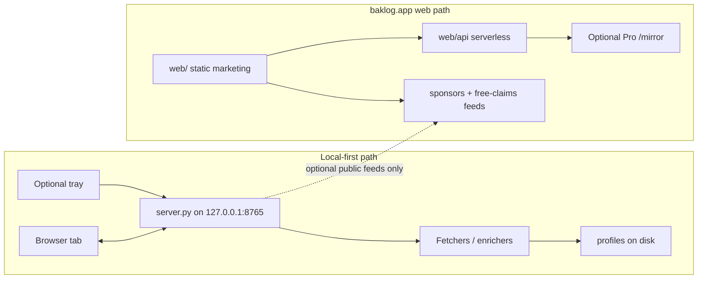

# Architecture (public)

High-level map of the MIT-licensed app in this repo. Maintainer-only deep docs
live in the private `baklog-internal` clone; this file is the public overview
for contributors and security reviewers.

## What BAKLOG is

A **local-first** desktop app: a Python HTTP server on `127.0.0.1:8765` serves a
vanilla-JS dashboard and orchestrates **subprocess fetchers** that read **your**
store libraries using **your** credentials. There is no multi-tenant cloud
catalog. Optional Supabase auth and Polar Pro are add-ons; the same codebase
runs without them.

## Repo layout

| Path | Role |
|------|------|
| `server.py` | HTTP router, run queue, static files, most `/api/*` handlers |
| `shared/` | Extracted server helpers (auth routes, updates, install paths, sponsors validation) |
| `auth/` | CDP browser sign-in, encrypted secrets, connect loops |
| `fetchers/` | Store scripts + `manifest.json` registry |
| `enrichers/` | HLTB, ITAD, tags, cross-store images |
| `js/` | Dashboard ESM modules (`app.js` bootstraps) |
| `profiles/<id>/` | Per-profile catalogs, personal data, auth CDP profiles (gitignored at runtime) |
| `packaging/` | PyInstaller spec, Inno Setup, apply-update scripts |
| `web/` | Static marketing site (Vercel); separate from the local app |
| `guide/` | End-user documentation |

## Runtime

Frozen builds bundle Python + assets via PyInstaller; data defaults to
`%LOCALAPPDATA%\BAKLOG-Data` (or co-located with `portable.txt`). Public
architecture decisions: [`docs/adr/`](docs/adr/README.md).

## Network calls (honest)

Your **library JSON and Connections secrets are not uploaded** to a BAKLOG
backend. These **do** reach the network from a normal install:

| Destination | Purpose | Personal data sent? |
|-------------|---------|---------------------|
| Store APIs / sites | Fetch **your** libraries (as you) | Your session only |
| `github.com` | Optional in-app update check + zip download | Version check only |
| `baklog.app` | Public `free-claims.json`, `sponsors.json` feeds; optional waitlist/report/metrics APIs; marketing-site Google Analytics | Feeds: none. Metrics: **opt-in only** (`shareAnonStats`). Reports: **you** submit. GA: marketing pages only |
| `*.supabase.co` | Optional login | Auth metadata if enabled |
| Polar / checkout URLs | Optional Pro purchase | Payment on Polar |

See [PRIVACY.md](PRIVACY.md) for the full host list.

## Why `server.py` is large

`server.py` remains the integration point (CI line budget **3000**; currently
well under that after extraction). New work moves into `shared/`
(`update_api.py`, `server_internal_routes.py`, `run_manager.py`, auth helpers).
Further splits are incremental, not a rewrite.

## Headless, Connect, and keyring

- The server **binds to `127.0.0.1` only** by default (not LAN).
- **Connect** uses a **headed** Chrome/Edge CDP window so you can complete
  store sign-in yourself. After credentials are stored, many library fetches
  can run without a visible browser (session replay / API clients).
- Secrets prefer the OS **keyring**. If keyring is unavailable, BAKLOG falls
  back to a local `.master_key` file (weaker; see [SECURITY.md](SECURITY.md)).
- Per-store Connect and CLI notes: [guide/connecting-stores.md](guide/connecting-stores.md).

## Store access and ToS

Fetchers use a mix of official APIs, OAuth, and **replaying your own web
session** (CDP sign-in). Several stores are **gray** under their terms. We
document this plainly in [SECURITY.md](SECURITY.md); you run it at your own
risk.

## Pro / license

Without Supabase, Pro is **`license.json` on disk** (honor system for local dev;
Polar activation for paid users). With Supabase, plan comes from JWT / admin
metadata. Source is public; paying supports development, not a secret fork.

## Open source vs open beta

- **MIT + full source** in this repo (server, fetchers, UI, packaging scripts).
- **Open beta** means packaged builds and rollout pacing, not hidden code.
- **Gitignored** paths: personal `profiles/`, `games_*.json`, `.env`, and
  maintainer-only `admin/`, `marketing/`, internal `docs/` (synced to private repo).

## Tests and CI

- Default `pytest` skips `@integration` (real Chrome) and `@release_smoke`.
- Ubuntu CI: full fast suite + slow lane; Windows/macOS: smoke subsets.
- Vitest covers JS modules; sync-pair tests guard duplicated constants.

See [CONTRIBUTING.md](CONTRIBUTING.md) for running locally.

## Clarifications

| Claim | Reality |
|-------|---------|
| "No telemetry" | **No telemetry by default.** Opt-in anonymous aggregate metrics exist (Settings). |
| "Nothing phones home" | Store fetches + optional GitHub updates + public baklog.app feeds. **Not** your library upload. |
| "Not real OSS" | MIT app tree is here; invite gate is distribution, not license. |
| "Pro is DRM" | Local license file + optional Supabase plan; documented in `shared/entitlement.py`. |
| "Electron would be simpler" | Deliberate choice: stdlib server + browser tab + PyInstaller (smaller, auditable). |

## Out of scope

| Topic | Stance |
|-------|--------|
| Electron / Chromium shell | Not used. Browser tab + PyInstaller tray. |
| Multi-tenant cloud catalog | Libraries stay on the user machine. |
| In-app AI picks / recommendations | Not a product feature. Do not claim otherwise. |
| Credential or auth-profile sync | Never uploaded; mirror allowlist excludes secrets. |
| CAPTCHA solving / pooled scraping | Not done. Sign-in is the user's own headed browser session. |
| Silent background app updates | Check-then-click only. |
| Defending against local malware | Out of scope; OS user is the trust boundary. |
| Binding the server on LAN (`0.0.0.0`) | User responsibility; default is localhost. |

## Rough edges (honest status)

| Edge | Status | Notes |
|------|--------|-------|
| `server.py` size | Improving | Run/RunManager moved to `shared/run_manager.py`; CI line budget ratcheted |
| `connections.js` size | Improving | Rail/status in `js/connections-rail.js`; session flows remain in barrel |
| `fetcher-health.js` | Done | Barrel + `js/fetcher/` split (#91) |
| Dev vs frozen localStorage | Mitigated | Prefer `PORT=8766` + `BAKLOG_DATA_DIR` for dev; error log is partitioned per runtime (`baklog-error-log:dev` / `:installed`); admin refuses default installed data root unless `BAKLOG_ADMIN_ALLOW_INSTALLED=1` |
| macOS frozen zip | Deferred | Notify-only until `BAKLOG-macos.zip` ships; checklist in `packaging/build_macos.sh` |
| Windows ARP version drift | Visible | Diagnostics + update install footnote when Setup + zip apply diverge |
| Code signing | Windows: gated | `release.yml` signs bundle exes + `BAKLOG-Setup.exe` with Azure Artifact Signing when `SIGNING_ENABLED=true` (`scripts/sign_windows_artifacts.ps1` lists/verifies); local builds and macOS/Linux stay unsigned |
